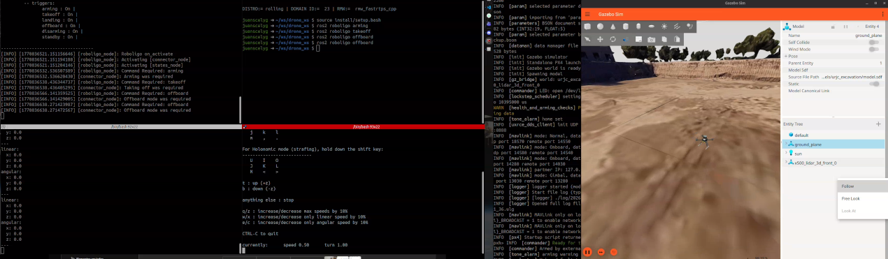

# roboligo

[](https://github.com/juanscelyg/roboligo/actions/workflows/rolling.yml)
[](https://github.com/juanscelyg/roboligo/actions/workflows/jazzy.yml)
[](https://github.com/juanscelyg/roboligo/actions/workflows/humble.yml)

Roboligo is a centralized command interface layer that bridges navigation stacks and hardware interfaces for robotic systems. It provides a unified abstraction for robot control, simplifying the complexity of managing diverse hardware implementations while maintaining compatibility with standard navigation algorithms.



## Key Features

- **Centralized Command Interface**: Standardize robot instructions across different platforms
- **Hardware Abstraction Layer**: Decouple navigation logic from hardware-specific implementations
- **Modular Design**: Easy integration with various robot morphologies and sensor configurations

This architecture allows developers to focus on high-level navigation strategies without worrying about the underlying hardware details, fostering innovation and accelerating development cycles in robotic applications.

The connectors components are designed to be modular and extensible, allowing for easy integration of new robot types and hardware configurations. This flexibility ensures that roboligo can adapt to a wide range of robotic platforms, from wheeled robots to legged systems, while maintaining a consistent interface for navigation and control. This is possible to use plugins to connect and configure any robot.

## Installation

### Clone and Build

```bash
cd ~/ros2_ws/src
git clone https://github.com/juanscelyg/roboligo.git
cd ~/ros2_ws
colcon build --symlink-install
source install/setup.bash
```

## Quick Start

Roboligo provides one launcher per autopilot connector. Each launcher loads its own parameter file from `roboligo/params`:

| Launcher | Parameter file | Connector plugin | Communication |
|----------|----------------|------------------|---------------|
| `roboligo_mavros.launch.py` | `drone_mavros.params.yaml` | `roboligo_connector_mavros/RoboligoConnectorMavros` | MAVLink through MAVROS |
| `roboligo_px4.launch.py` | `drone_px4.params.yaml` | `roboligo_connector_px4/RoboligoConnectorPX4` | PX4 native topics through uXRCE-DDS |

Launch roboligo with MAVROS:

```bash
ros2 launch roboligo roboligo_mavros.launch.py
```

Or launch roboligo with the native PX4 connector:

```bash
ros2 launch roboligo roboligo_px4.launch.py
```

To use your own configuration, edit the parameter file loaded by the launcher (or copy the launcher and point `params_file` to your configuration file containing robot-specific parameters).

The structure of the configuration file is shown below:

```yaml
states_node:
  ros__parameters:
    use_sim_time: true
    robot_types: [<robot_type>]
    <robot_type>:
      plugin: <plugin_name>

connector_node:
  ros__parameters:
    use_sim_time: true
    connector_types: [<connector_type>]
    <connector_type>:
      plugin: <plugin_name>

roboligo_node:
  ros__parameters:
    use_sim_time: true
    robot_name: <robot_name>
    input_topic: <topic_name>
    stamped: <use_stamped>
```

## Connector Plugins

### MAVROS connector (`roboligo_connector_mavros`)

Sends commands to the autopilot using MAVLink through [MAVROS](https://github.com/mavlink/mavros). MAVROS must be running and connected to the flight controller before launching roboligo.

### PX4 connector (`roboligo_connector_px4`)

Talks directly to PX4 using its native uORB topics exposed over DDS (`/fmu/in/*` and `/fmu/out/*`), without MAVLink or MAVROS. The PX4 message definitions (`px4_msgs` v1.16.0) are downloaded automatically at build time, so the PX4 firmware should use a matching version.

Requirements:

- PX4 (SITL or hardware) with the uXRCE-DDS client enabled.
- The Micro XRCE-DDS Agent running. In simulation, you can start it using either of these alternatives:

Using the `micro_ros_agent` ROS 2 package (installed as a dependency of the connector):

```bash
ros2 run micro_ros_agent micro_ros_agent udp4 --port 8888
```

Or using the standalone Micro XRCE-DDS Agent:

```bash
MicroXRCEAgent udp4 -p 8888
```

Then launch roboligo:

```bash
ros2 launch roboligo roboligo_px4.launch.py
```

Parameters (under the connector name in `connector_node`):

| Parameter | Type | Default | Description |
|-----------|------|---------|-------------|
| `plugin` | string | — | `roboligo_connector_px4/RoboligoConnectorPX4` |
| `init_alt` | double | `0.5` | Takeoff altitude in meters above the current position |
| `verbose` | bool | `false` | Enables verbose logging of the vehicle status |

```yaml
connector_node:
  ros__parameters:
    use_sim_time: true
    connector_types: [px4]
    px4:
      plugin: roboligo_connector_px4/RoboligoConnectorPX4
      init_alt: 0.75
```

Topics used by the plugin:

| Direction | Topic | Message |
|-----------|-------|---------|
| Publish | `/fmu/in/vehicle_command` | `px4_msgs/VehicleCommand` |
| Publish | `/fmu/in/offboard_control_mode` | `px4_msgs/OffboardControlMode` |
| Publish | `/fmu/in/trajectory_setpoint` | `px4_msgs/TrajectorySetpoint` |
| Subscribe | `/fmu/out/vehicle_status_v1` | `px4_msgs/VehicleStatus` |
| Subscribe | `/fmu/out/vehicle_odometry` | `px4_msgs/VehicleOdometry` |
| Subscribe | `/fmu/out/vehicle_global_position` | `px4_msgs/VehicleGlobalPosition` |
| Subscribe | `/fmu/out/sensor_combined` | `px4_msgs/SensorCombined` |
| Subscribe | `/fmu/out/vehicle_gps_position` | `px4_msgs/SensorGps` |
| Subscribe | `/fmu/out/battery_status` | `px4_msgs/BatteryStatus` |
| Subscribe | `/cmd_vel` | `geometry_msgs/Twist` (or `TwistStamped` when `stamped: true`) |

Behavior of each trigger with PX4:

- `arming` / `disarming`: `VEHICLE_CMD_COMPONENT_ARM_DISARM`.
- `takeoff`: `VEHICLE_CMD_NAV_TAKEOFF` to the current AMSL altitude plus `init_alt`. If no global position has been received yet, PX4 falls back to `MIS_TAKEOFF_ALT`.
- `landing`: `VEHICLE_CMD_NAV_LAND`.
- `offboard`: switches PX4 to Offboard mode in velocity control. From then on, the velocity commands received on `/cmd_vel` (body FLU, ROS convention) are converted to NED velocity setpoints using the vehicle heading and published on `/fmu/in/trajectory_setpoint`. Velocities are only sent while Offboard is active and a valid heading has been received from `/fmu/out/vehicle_odometry`.
- `standby`: switches PX4 to Position mode, holding the current position. Any other trigger (takeoff, landing, standby, disarming) stops sending velocity setpoints.

## Usage

Once roboligo is running, you can send commands to the robot using standard ROS 2 cli. For example, to send an instruction to specific trigger configured previously in a plugin, you can use:

```bash
`ros2 roboligo <trigger_name>`
```

Where `<trigger_name>` corresponds to the name of the trigger defined in your configuration. This command will send the appropriate instruction to the robot based on the configured trigger, allowing for seamless control and interaction with the robotic system.

Currently is available the following triggers:

- `arming`: Arm the robot
- `disarming`: Disarm the robot
- `takeoff`: Command the robot to take off
- `landing`: Command the robot to land
- `offboard`: Command the robot to offboard mode
- `standby`: Command the robot to keep the robot at current position

Those implementation are available using plugins (more plugins coming soon) and can be used for any robot, but currently are tested with a quadrotor using both the MAVROS and the PX4 connectors.

## Integration

Roboligo is developed in collaboration with [EasyNav](https://github.com/easynavigation), a navigation framework from the [Intelligent Robotics Lab](https://intelligentroboticslab.gsyc.urjc.es/) at URJC.

## Future Developments

Upcoming releases will extend support for diverse robot morphologies:

- Quadruped locomotion systems
- Bipedal robots
- Underwater vehicles (AUVs)

These extensions will maintain the same centralized interface paradigm, enabling seamless control across different robotic platforms.

## Contributing

Contributions to roboligo are welcome! Please follow these guidelines:

1. Fork the repository and create a new branch for your feature or bug fix.
2. Ensure your code adheres to the existing style and includes appropriate documentation.
3. Submit a pull request with a clear description of your changes and the problem they address.

## License

This project is licensed under the Apache License 2.0. See the LICENSE file for details.
